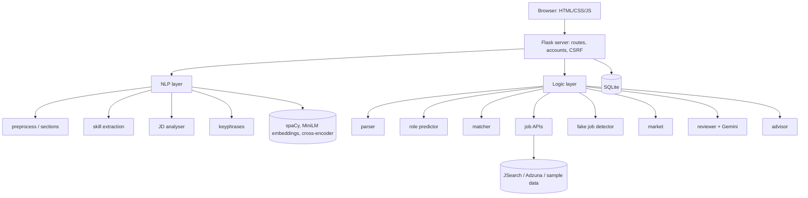
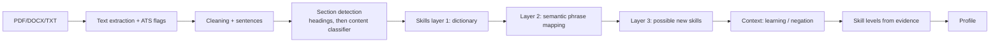
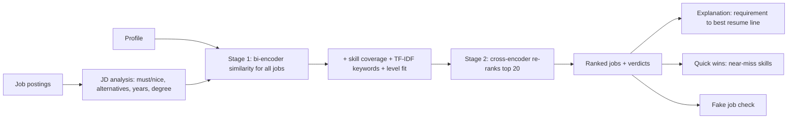

# Architecture

## System overview

## Resume pipeline

## Matching pipeline

## Data flow between pages
Profile (targets) -> Jobs (search + ranking, stored per user) -> Match / Market / Prepare.
Ticking a skill in the plan adds it to the profile, which refreshes matches and readiness.

## Database tables
users, resumes, profiles, job_cache, results, saved_jobs, progress, fundamentals, readiness_history, settings.
